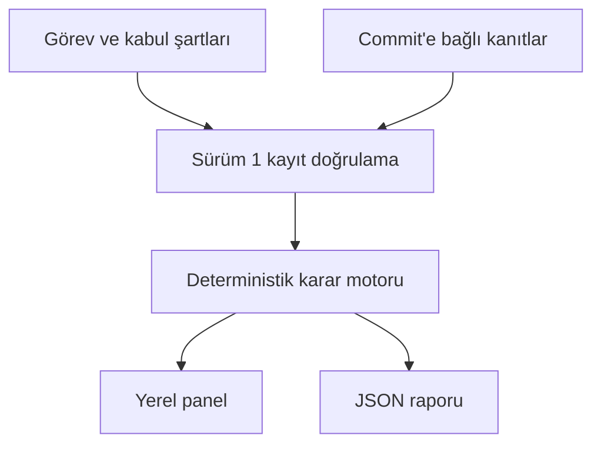
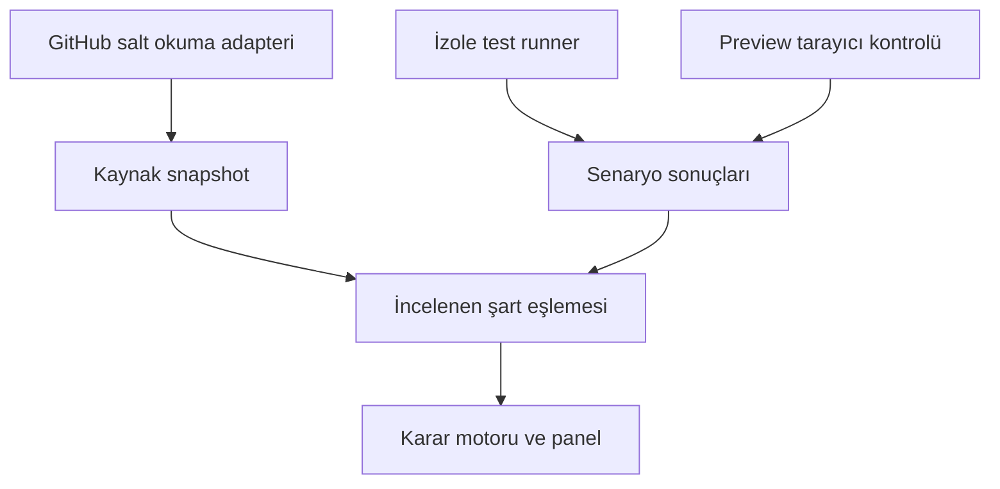

# TaskProof mimarisi — v0.1

## Amaç
Bir PR'ın tanımlı kabul şartları için hangi kanıtların bulunduğunu göster. Doğrulama kapsamını, eksikliği ve commit tazeliğini görünür kıl. Hatasız yazılım veya otomatik merge garantisi verme.

## Çalışan katman

- `src/engine.mjs`: saf şema kontrolü ve karar fonksiyonu. Sunucu ve tarayıcı aynı motoru kullanır.
- `src/server.mjs`: yalnız localhost 4317; sabit GET route listesi ve aynı-origin POST /api/github. Repo dosyalarını genel statik dizin olarak açmaz.
- `public/`: bağımlılıksız arayüz; dinamik metinler textContent ile yazılır. Dış font/CDN/script yok.
- `data/`: GitHub bağlantısıyla alınan manuel snapshot ve ayrı sentetik fixture. Tarihli, tam commit SHA ile kayıt.
- `src/report.mjs`: aynı motorla komut satırı çıktısı.

## Adapterler ve sonraki runner katmanı

GitHub metadata adapteri `src/github.mjs` ve incelenen sonuç adapteri `src/scenarios.mjs` uygulanmıştır. Metadata kendi başına kabul şartı doğrulamaz. Sonuç dosyaları operatörce alınır; `src/import-results.mjs` repo/PR/SHA/run/attempt ve eşleme alanlarını kontrol eder. Runner ve kaynak preview testleri sonraki görevlerdir.

## Veri ilişkileri
| Nesne | Kimlik ve bağlantı |
|---|---|
| Proje | owner/repo |
| PR snapshot | proje + PR numarası + tam head SHA + collectedAt |
| Kabul şartı | snapshot içinde benzersiz AC-ID + requiredLevel |
| Kanıt | benzersiz E-ID + commitSha + kind + outcome + provenance |
| Eşleme | kanıt.criterionIds → aynı snapshot kriterleri |
| Senaryo sonucu | caseName + runId + observedAt + mappingReviewedBy |
| Rapor | snapshot'tan yeniden hesaplanır; kayıtlı eski karar körlemesine kullanılmaz |

## Karar sırası
1. Girdi doğrulaması başarısızsa sonuç üretme.
2. Aynı SHA ve doğrudan kanıt türünü seç.
3. Güncel doğrudan failure varsa başarısız; success bunu gizlemez.
4. Güncel doğrudan success varsa tanımlı kanıt düzeyinde doğrulandı.
5. Tüm bağlı kanıtlar eski SHA ise kanıt eski.
6. Diğer durumlar kanıt yetersiz. Genel CI, claim, kaynak testi davranış düzeyinde kabul edilmez.

## Güven sınırı ve bilinen sınırlar
v0.1 operatörün JSON kaydına güvenir. `mappingReviewedBy` bir beyan alanıdır; oturum açmış kimlik değildir. Bu sürüm içe aktarılan testin gerçekliğini ya da mapping'in semantik doğruluğunu otomatik kanıtlamaz. Snapshot'ın collectedAt değeri bir canlı bağlantı garantisi değildir. GitHub adapterinde head_sha ve run head_sha gerçek API cevabından eşleşmelidir. Test bazlı loglar yoksa genel CI'dan senaryo sonucu türetilmez.

UI'de ağdan model kullanımı yok. Kalıcı veritabanı, hesap yönetimi ve arka plan iş kuyruğu henüz yok. İçe aktarılan kayıt yenilemede kaybolur; dosya/rapor indirilerek korunur.

## Teknoloji seçimi
Node.js >=22, built-in HTTP/fs/test, modern tarayıcı ES module. Bilgisayarda Node 22.18.0 mevcut. Bu prototip için framework veya veritabanı zorunlu değil. Runner ayrı süreç/ortam olmalı; dashboard sunucusuna shell execution endpoint eklenmez.
