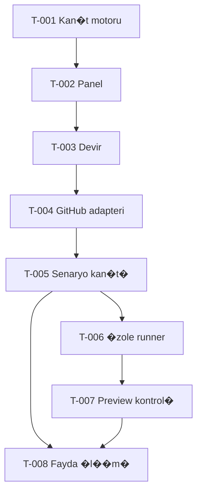

Current task T-016: user explicitly added credit; one new bounded hosted baseline authorized. T-015 completed with credit_balance_exhausted, not a generated response. Same prompt/input, no automatic retries. See tasks/T-016.md.

Current task T-015: user account update followed by one authorized baseline request; safe code-level 429 diagnostics and no automatic retry. Plan tasks/T-015.md. Prior T-014 HTTP429 remains evidence; comparison not completed.

Current task T-014: one newly authorized hosted OpenAI baseline using the user-added repository secret. Same shared prompt and input, ~USD0.001 list-price preflight limit, no retries. Actual result pending; prior failed request remains evidence. See tasks/T-014.md.

Current checkpoint: T-013 one approved OpenAI baseline attempted; transport failed with unknown provider outcome. Comparison blocked, no automatic retry. Full observations and review in research/seo-comparison/first-pair-review.md.

Current checkpoint: T-012 first Gemini one-case generation completed in run 39969638630 (one request). Assistant quality review needs revision. Matched baseline and blinded human evaluation remain open. Result and review are in PR #13; no more generation requests in this task.

# G�rev ba�lant�lar�

| G�rev | Durum | Ba��ml�l�k | Somut ��kt� |
|---|---|---|---|
| T-001 Kan�t s�zle�mesi ve karar motoru | Tamamland� | Yok | engine + testler + evidence-contract |
| T-002 Yerel panel ve �rnek kay�t | Tamamland� | T-001 | ger�ek snapshot + sentetik demo + import/export |
| T-003 Do�rulama ve ta��nabilir devir | Tamamland� - PR #2 squash | T-001, T-002 | GitHub'da 16/16 + 6 Chromium senaryosu; run 39803038748 |
| T-004 GitHub salt okuma adapteri | Tamamland� - PR #3 squash | T-003 | 27/27 test, 7 Chromium, canl� salt okuma; run 39803768215 |
| T-005 Senaryo kan�t� alma ve e�leme | Tamamland� - PR #4 squash | T-004 | 38/38 test, 7 Chromium, run 39804912250; operat�r importu |
| T-006 �zole runner tasar�m� ve uygulamas� | Tamamland� - PR #5 squash | T-005 | 42/42, 7 Chromium ve ger�ek Docker limit denemeleri; run 39806257000 |
| T-007 Preview davran�� kontrol� | Admin mevcut; origin d�zeltmesi yay�nda; oturumlu tekrar test a��k | T-005, T-006 | Source #176, 762/762; g�ncel preview READY; ger�ek start/continue do�rulanmal� |
| T-008 Ger�ek fayda deneyi | �n �l��m haz�r; insan kar��la�t�rmas� a��k | T-005; UI �artlar� i�in T-007 | 3 se�ilmi� olumlu kriter, 5 kan�t eksikli�i; zaman kazanc� �l��lmedi |

## Kullan�c�n�n g�ncel ara�t�rma hatt� - 23 Ekim 2026

| G�rev | Durum | Ba��ml�l�k | Somut ��kt� |
|---|---|---|---|
| T-009 �cretsiz AI ara� ara�t�rmas� ve deney haz�rl��� | Haz�rl�k tamam; yerel 43/43; PR/CI GitHub'da | Yok; g�ncel kullan�c� �nceli�i | research/ k�sa liste, protokol, 10 sentetik vaka, bo� sonu� tablosu |
| T-010 Ger�ek SEO �nerisi kar��la�t�rmas� | Offline aktar�m haz�r; 49/49 test; canl� A/B eri�im/baseline bekliyor | T-009 | 10 reported vaka, Promptfoo test aktar�m�, bo� �l��m �ablonu; kazanan yok |
| T-011 Gemini metadata eri�imi | Tamamland�; run 39966873913 HTTP 200 | GEMINI_API_KEY repository secret | metadata_ok; �retim/kota do�rulamas� de�il |
| T-012 First Gemini SEO request | Completed: run 39969638630; quality needs revision | T-011; user Free Tier confirmation | 1257ms, 496 tokens; no matched baseline |

Ara�t�rma hatt� mevcut TaskProof g�revlerini tamamlanm�� saymaz ve runtime'a yeni �zellik eklemez.

Bir g�revde �al��ma bitince durum, test ve a��k madde ilgili g�rev dosyas� ile STATE.md'de birlikte g�ncellenir.
