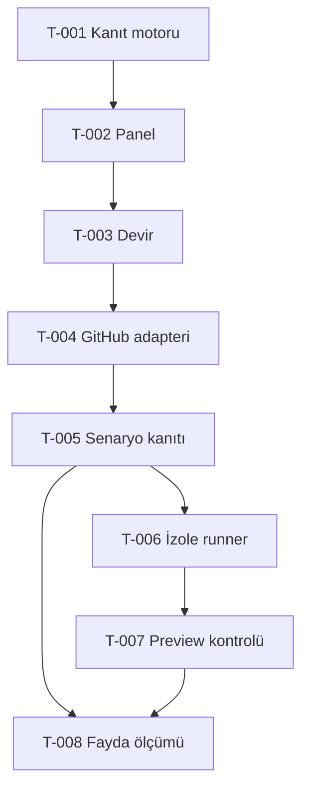

# Görev bağlantıları

| Görev | Durum | Bağımlılık | Somut çıktı |
|---|---|---|---|
| T-001 Kanıt sözleşmesi ve karar motoru | Tamamlandı | Yok | engine + testler + evidence-contract |
| T-002 Yerel panel ve örnek kayıt | Tamamlandı | T-001 | gerçek snapshot + sentetik demo + import/export |
| T-003 Doğrulama ve taşınabilir devir | Kısmi; gerçek tarayıcı kontrolü bekliyor | T-001, T-002 | motor/handler testleri geçti; loopback ve UI engelli; belgeler hazır |
| T-004 GitHub salt okuma adapteri | Planlandı, başlanmadı | T-003 | PR/head/run metadata; SHA ve sayfalama testleri |
| T-005 Senaryo kanıtı alma ve eşleme | Bekliyor | T-004 | test sonuçları + incelenen kriter eşlemeleri |
| T-006 İzole runner tasarımı ve uygulaması | Bekliyor | T-005 | secret taşımayan sınırlı test ortamı |
| T-007 Preview davranış kontrolü | Bekliyor | T-005, T-006 | uygun önizleme üzerinde tarayıcı senaryoları |
| T-008 Gerçek fayda deneyi | Bekliyor | T-005; UI şartları için T-007 | olumlu/eksik PR karşılaştırması ve süre ölçümü |

Bir görevde çalışma bitince durum, test ve açık madde ilgili görev dosyası ile STATE.md'de birlikte güncellenir.
