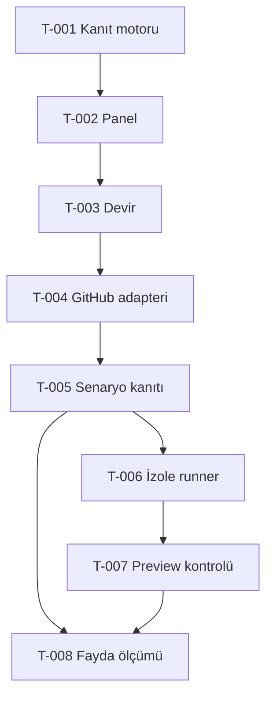

# Görev bağlantıları

| Görev | Durum | Bağımlılık | Somut çıktı |
|---|---|---|---|
| T-001 Kanıt sözleşmesi ve karar motoru | Tamamlandı | Yok | engine + testler + evidence-contract |
| T-002 Yerel panel ve örnek kayıt | Tamamlandı | T-001 | gerçek snapshot + sentetik demo + import/export |
| T-003 Doğrulama ve taşınabilir devir | Tamamlandı — PR #2 squash | T-001, T-002 | GitHub'da 16/16 + 6 Chromium senaryosu; run 39803038748 |
| T-004 GitHub salt okuma adapteri | Tamamlandı - PR #3 squash | T-003 | 27/27 test, 7 Chromium, canlı salt okuma; run 39803768215 |
| T-005 Senaryo kanıtı alma ve eşleme | Tamamlandı - PR #4 squash | T-004 | 38/38 test, 7 Chromium, run 39804912250; operatör importu |
| T-006 İzole runner tasarımı ve uygulaması | Tamamlandı - PR #5 squash | T-005 | 42/42, 7 Chromium ve gerçek Docker limit denemeleri; run 39806257000 |
| T-007 Preview davranış kontrolü | Test altyapısı hazır; ilk admin/oturum bekleniyor | T-005, T-006 | Ayrı DB, kısıtlı rol, doğru SHA READY; PV-01 giriş yönlendirmesi görüldü |
| T-008 Gerçek fayda deneyi | Ön ölçüm hazır; insan karşılaştırması açık | T-005; UI şartları için T-007 | 3 seçilmiş olumlu kriter, 5 kanıt eksikliği; zaman kazancı ölçülmedi |

Bir görevde çalışma bitince durum, test ve açık madde ilgili görev dosyası ile STATE.md'de birlikte güncellenir.
